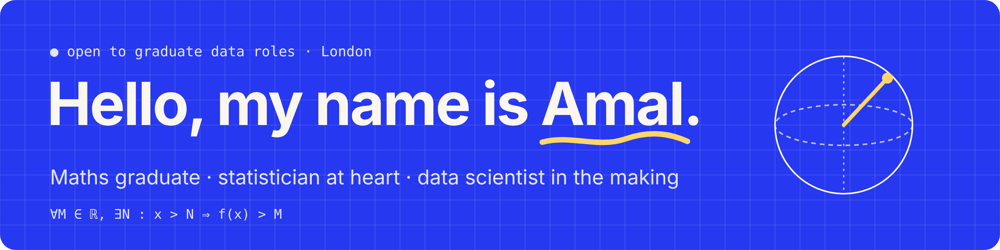
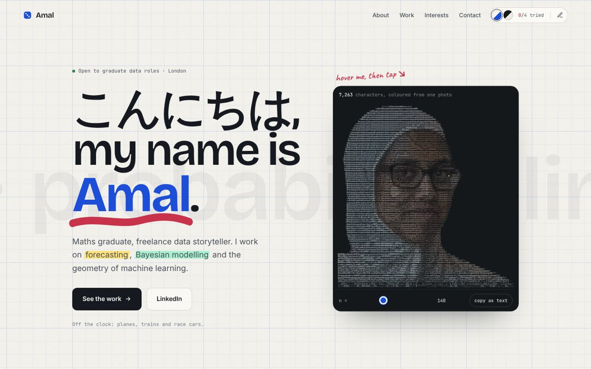
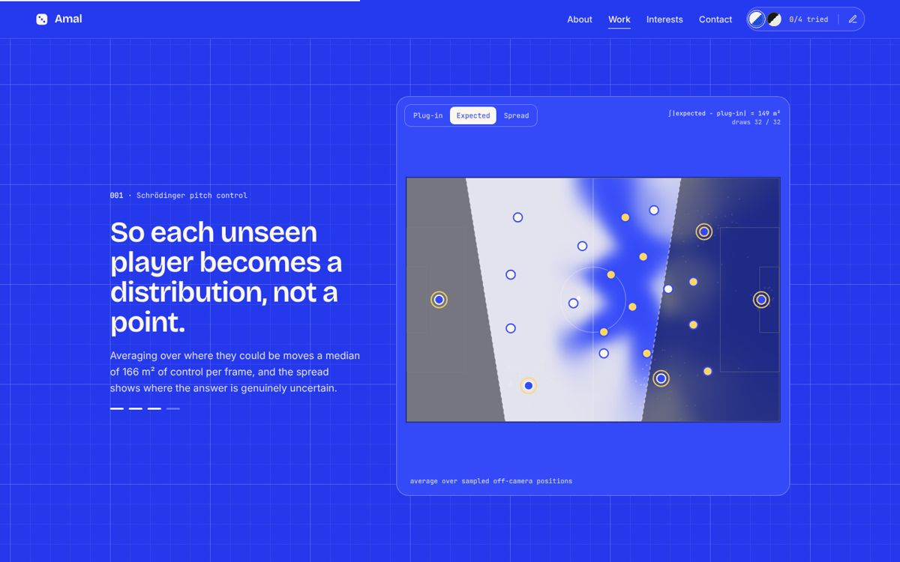
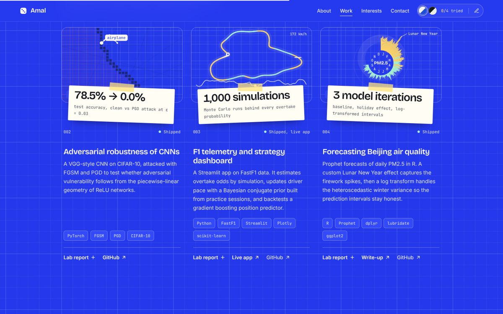
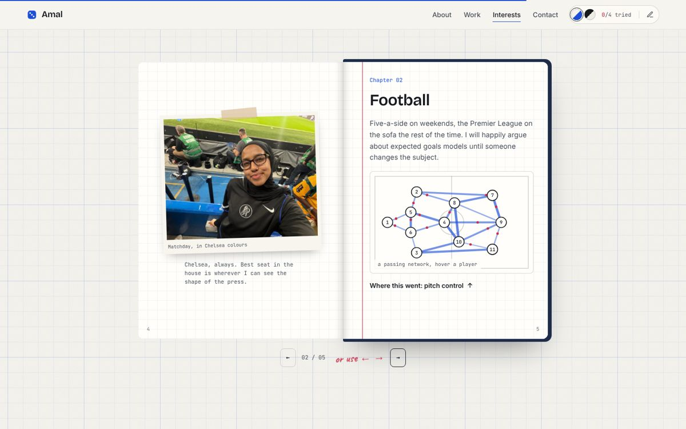

<a href="https://amalabdirahman.github.io/AmalAbdirahman/">
  <picture>
    <source media="(prefers-color-scheme: dark)" srcset="readme/images/banner-dark.png">
    
  </picture>
</a>

  
  
  

### 👋 Hi, I'm Amal

I build models that say **how sure they are**: forecasting, Bayesian inference and machine learning, on real data that is never complete. It started with linear algebra, statistics pulled me in properly, and now I put the maths to work on data that persuades.

📈 Open to graduate roles in **data science, machine learning and analytics**, in London or remote.

---

### 🌐 The portfolio

My site is an interactive notebook: a portrait drawn in characters, dice that prove the central limit theorem, a pitch control model you can drag around, and a notebook of my interests that turns as you scroll.

<table>
  <tr>
    <td width="50%"></td>
    <td width="50%"></td>
  </tr>
  <tr>
    <td></td>
    <td></td>
  </tr>
</table>

---

### 🔬 Selected work

| | Project | Headline |
|:-:|---|---|
| ⚽ | **[Schrödinger pitch control](https://github.com/AmalAbdirahman/schrodinger-pitch-control)** Extends Spearman's pitch control model to broadcast tracking data, where off-camera players become calibrated probability distributions instead of points. *SkillCorner Analytics Cup, research track.* | **40.7%** of player-frames off camera 93.1% coverage at nominal 95% |
| 🧠 | **[Adversarial robustness of CNNs](https://github.com/AmalAbdirahman/cnn-geometric-analysis)** Attacks a CIFAR-10 CNN with FGSM and PGD to test whether adversarial vulnerability follows from the geometry of ReLU networks. | **78.5% → 0.0%** accuracy under a small attack |
| 🏎️ | **[F1 telemetry and strategy dashboard](https://github.com/AmalAbdirahman/f1-telemetry-dashboard)** Monte Carlo overtake odds, Bayesian updating of driver pace from practice, and a backtested position predictor. [**Live app →**](https://formula1-telemetry-dashboard.streamlit.app/) | **1,000** simulations per overtake probability |
| 🌫️ | **[Forecasting Beijing air quality](https://github.com/AmalAbdirahman/beijing-air-quality-prophet)** Prophet forecasts of daily PM2.5 in R, with a Lunar New Year effect and log-transformed intervals for volatile winters. [**Write-up →**](https://amalabdirahman.github.io/beijing-air-quality-prophet/) | **3** model iterations honest intervals |

**Also worth a look:**
- 🎙️ **[PitchSide](https://github.com/AmalAbdirahman/PitchSide):** an LLM drafts live match facts, and deterministic code verifies every claim before it can air.
- 🏥 **[Hospital readmissions (SQL)](https://github.com/AmalAbdirahman/hospital-readmissions-sql):** found 45% of consecutive visit pairs had impossible timelines, and measured the impact instead of hiding it.
- 🔀 **[Simpson's paradox](https://github.com/AmalAbdirahman/SimpsonsParadox):** how aggregated statistics can reverse a trend, with GLMs and a worked case study.

---

### ∀ε > 0: a proof, animated

  <picture>
    <source media="(prefers-color-scheme: dark)" srcset="readme/images/proof-dark.gif">
    
  </picture>
   For every height M, there is an N beyond which f(x) stays above it. Rendered with <a href="https://manimgx.academa.ai/">ManimGX</a> from <code>animations/divergence.py</code>.

---

### 🛠️ Toolkit

  
  
  
  
  
  
  
  

`Bayesian inference` `time series` `Monte Carlo` `high-dimensional statistics` `data visualisation`

---

### 📓 Off the clock

🏎️ Motorsport · ⚽ Football · ✈️ Planes · 🚆 Trains · 🔌 electrical engineering, semiconductors and quantum computing

---

<b>📁 About this repository</b>

 

This repo hosts my portfolio (`index.html`, served by GitHub Pages).

- `animations/`: the ManimGX scene for the animated proof; rendered clips live in `assets/`.
- `figures/`: isometric machine figures built with the [Anatomy](https://github.com/wheresryan22/anatomy) skill.
- `readme/images`: images for this page.

CV available on request · Built with mathematics and stubborn curiosity

